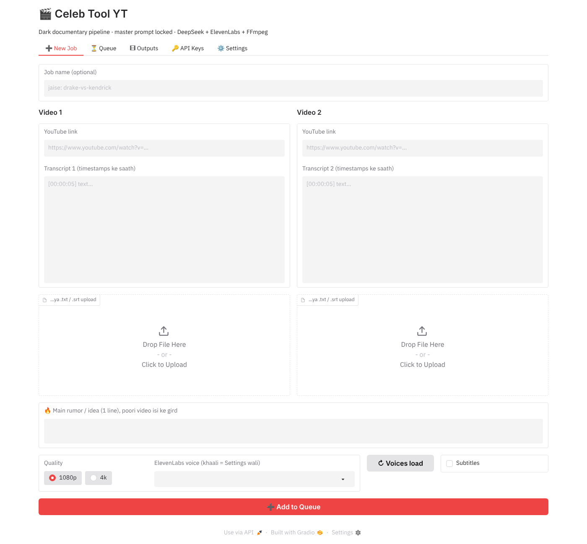

# Celeb Tool YT — Dark Documentary Pipeline (M1 Pro, local)



Input: 2 competitor video links + unke timestamped transcripts + 1-line rumor
Output: 17–20 min ki final video (1080p/4K) + script + clip log + stems + titles/description/thumbnail

## Setup (ek dafa)

```bash
cd docforge
git clone https://github.com/haseeb109/Celeb-Tool-YT.git && cd Celeb-Tool-YT
./install.sh            # Homebrew, ffmpeg, yt-dlp, uv, Python env, mlx-whisper
.venv/bin/python app.py # GUI khulega
```

GUI mein:
1. **🔑 API Keys** tab: Deploy aur ElevenLabs keys paste karo, Save karo, phir Test karo. Keys sirf aapke Mac par `.env` mein rehti hain, GitHub par nahi jati.
2. **⚙️ Settings** tab: default voice, quality aur music upload (ek dafa). "Run doctor" se sab check ho jata hai.
3. **➕ New Job**: links, transcripts aur rumor daal kar Add to Queue karo.
4. **⏳ Queue**: Run Queue dabao. Har job ke stages live dikhte hain.
5. **🎞 Outputs**: video, script, clip log, QA report aur titles sab yahin dikhte hain.

GUI ki settings `settings.local.yaml` mein save hoti hain. `config.yaml` defaults rakhta hai aur master prompt ka lock bhi wahin hai.

## Chalana

**CLI / folder bulk:**
```bash
cp -r jobs/_example jobs/drake-feud        # job.yaml + transcript1.txt + transcript2.txt bharo
.venv/bin/python run.py run                # jobs/ ki saari pending jobs (raat bhar chhod do)
.venv/bin/python run.py run jobs/drake-feud --from voice --voice "Other Voice"   # sirf voice badalni ho
.venv/bin/python run.py list
```

## Stages (har stage resume-able: crash ho to wahin se shuru, paid calls dobara nahi lagti)

| # | Stage | Kya karta hai |
|---|---|---|
| 1 | ingest | yt-dlp se dono videos download, transcript ↔ video length check |
| 1b | style | competitor ka editing style naapta hai: shot length/pacing, zoom/pan speed, transitions (cut/flash/dip/crossfade), screen text ka style (Mac OCR), look (letterbox/vignette/grain), sound effects (whoosh/hit/riser) → `style_profile.json` |
| 2 | plan | DeepSeek: outline + montage + saari clips (sirf line IDs se) |
| 3 | write | DeepSeek: montage + har section alag call (word target enforce) |
| 4 | qa | Phase 1: Python checks · Phase 2: GLM independent audit → major galti ho to khud rewrite (max 3 rounds) |
| 5 | clips | exact clip cut (mlx-whisper se word-level edges), audio + video |
| 6 | voice | ElevenLabs (cache: same text dobara paid nahi hota) |
| 7 | visuals | narration ke neeche dono source videos ki related footage, dark grade, ALLEGED/CONFIRMED cards |
| 8 | assemble | concat + music ducking + optional subtitles + 1080p/4K |
| 9 | package | titles, description, chapters, tags, thumbnail |

## Master prompt lock
`prompts/master_prompt.txt` aapka prompt verbatim hai. Har run se pehle uska SHA-256 check hota hai: file mein ek character bhi badla to pipeline ruk jayegi. Jaan boojh kar badlo to `run.py relock`.
`prompts/pipeline_adapter.md` sirf delivery adapt karta hai (inputs ek saath, JSON output, clips line-ID se). Master prompt ka koi rule override nahi karta.

## Output (`output/<job>/`)
`<job>_1080p.mp4` · `script.md` + `script.docx` (montage, [PAUSE → PLAY CLIP], bold labels, callouts, CLIP LOG with actual video positions) · `clip_log.csv` · `subtitles.srt` · `stems/` · `thumbnail.jpg` · `packaging.md` · `qa_report.json` · `project.json`

## Tuning (config.yaml)
- `video.broll_crop.bottom: 12`: competitor videos ke burned subtitles crop karta hai. Logo upar ho to `top` badhao.
- `video.encoder: auto`: M1 par Apple hardware encoder (tez).
- `script.*`: word range, clip durations, QA rounds.
- `llm.*_reasoning`: `high` default. Sasta/tez chahiye to `low`.

## Competitor style replicate (free, local)
`video.replicate_style: true` ho to har job ki do source videos ka editing style naap kar aapki video mein copy hota hai. Ye sirf video layer hai, script aur master prompt par koi asar nahi.
- Pacing aur zoom PySceneDetect + OpenCV se, text style Apple Vision OCR (`ocrmac`) se.
- Ollama `qwen2.5vl:7b` effects pehchanta hai (16GB RAM par chal jata hai). `install.sh` ise khud install karta hai.
- Sound effects `assets/sfx/whoosh|hit|riser/` se aate hain. Pehli dafa basic set khud ban jata hai; apne SFX in folders mein daal do to wahi use honge.
